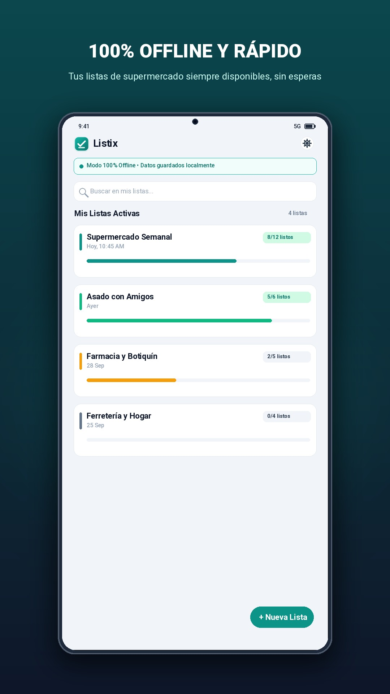
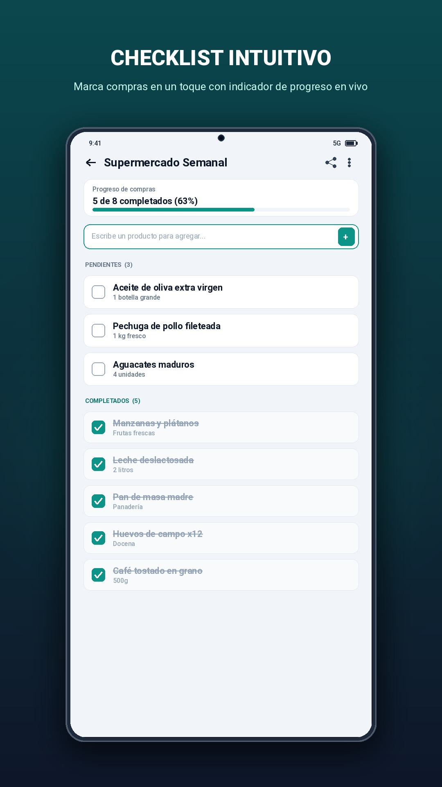
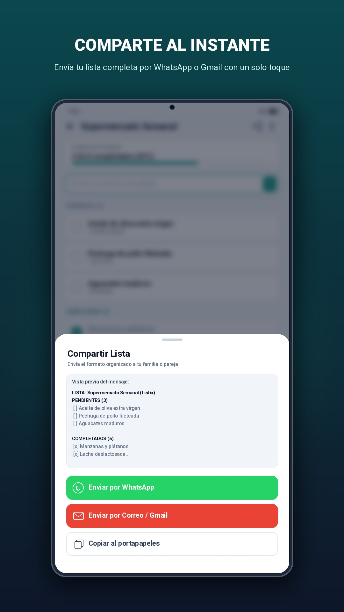
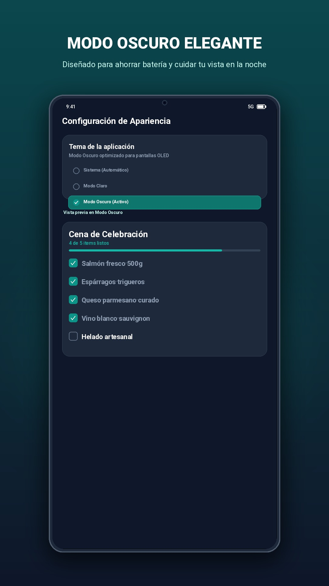
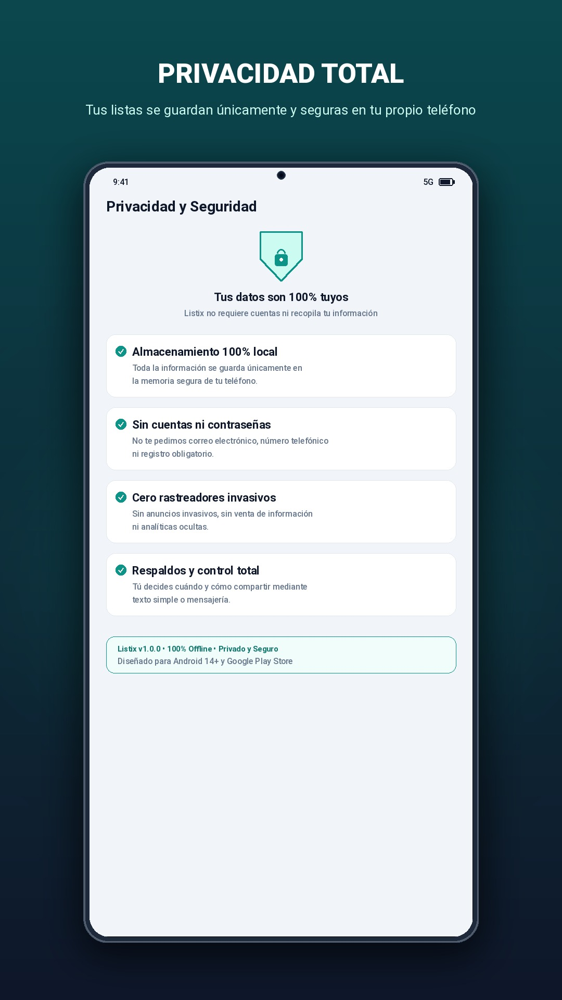

# Listix

[](https://github.com/nmenag/listix/actions/workflows/ci.yml)
[](https://github.com/nmenag/listix/actions/workflows/pr_checks.yml)
[](https://github.com/nmenag/listix/actions/workflows/release.yml)

A fast, minimalist, **offline-first** shopping and checklist mobile application built with Flutter, Dart 3, Material 3, SQLite local persistence, Riverpod, and real-time collaboration powered by Supabase.

<p align="center">
  
  
  
  
  
</p>

---

## 🎯 Overview & Vision

Listix is engineered for high-speed, everyday grocery and checklist management with an uncompromising commitment to local performance and seamless real-time collaboration:
- **Offline-First (Local SQLite)**: Instant operations with zero input lag. All lists and items are persisted locally on your device in SQLite. No network connection is needed to organize your private lists.
- **Offline Backup & Restore**: Export lists to JSON, CSV, or formatted Plain Text. Restore backups safely with overwrite or merge options using Android Storage Access Framework (SAF) and native share sheets.
- **Real-Time Collaboration**: Share lists with friends and family using a secure invite link or code. Changes sync instantly across all devices using Supabase Realtime synchronization.
- **Native Sharing & Deeplinks**: Share formatted lists directly through WhatsApp or Native Email, or copy an invite link. Integrated with app deeplinks to join a shared list seamlessly.
- **Dark Mode, Light Mode & System Default**: Tailored Material 3 themes with an intuitive appearance switcher in Settings.
- **Bilingual (English & Spanish)**: Full internationalization support with instant in-app language switching and system locale fallback.
- **App Store Optimization (ASO)**: Optimized metadata, keyword targeting, and concise benefit-driven microcopy (see [ASO Strategy](docs/ASO_COPY_OPTIMIZATION.md)).
- **Automated GitHub Releases**: CI/CD release workflow to build release APKs and App Bundles (AAB) with automated changelogs.

---

## 📱 Feature Scope

| Screen / Flow | Description |
| :--- | :--- |
| **1. Home / Lists Overview** | Scalable `ListixLogo` header, Settings action shortcut, list cards (with grid/list layout toggle), real-time pending progress badges, pull-to-refresh local reload, and swipe-to-delete. |
| **2. List Detail (ToDo Style)** | Header with list title, rename shortcut, share sheet trigger, real-time presence indicators, pending/completed counter with progress bar, and instant quick-add bottom bar. |
| **⚡ Quick Item Add** | Bottom input bar. Type item title and submit to immediately append to SQLite and broadcast via Supabase without leaving the keyboard. |
| **✓ Interactive Items** | Animated custom checkbox, strikethrough typography animation, opacity dimming for finished items, collapsible completed group, and swipe-to-delete. |
| **3. Create / Edit List** | Minimalist single-input focus screen for creating or renaming lists. |
| **4. Share List (Modal Sheet)** | One-tap sharing to invite collaborators via a secure link to join and sync the list in real-time. |
| **5. Join Invite / Collaboration** | Invite screen to accept invitations via deeplink or manual code entry. |
| **6. Settings & Appearance** | Appearance selector, language switcher, Backup shortcut, Privacy Policy, Terms of Service, version info, and Ads/Notifications configuration. |
| **7. Backup & Restore** | Export lists to JSON, CSV, or Plain Text summary. Restore backups safely with overwrite or merge strategies via Android Storage Access Framework (SAF) or native sharing. |

---

## 🏗️ Architecture & Project Structure

Listix adheres to **Feature-First Clean Architecture**:

```text
lib/
├── main.dart                               # App bootstrap with ProviderScope
└── src/
    ├── app.dart                            # MaterialApp.router with themeMode & localization delegates
    ├── routing/                            # Declarative navigation with GoRouter
    │   ├── app_router.dart
    │   └── routes.dart
    ├── features/
    │   ├── about/                          # About screen & metadata
    │   ├── ads/                            # Google Mobile Ads integration
    │   ├── backup/                         # Full backup, JSON/CSV export, SAF & restore
    │   ├── collaboration/                  # Supabase Realtime, presence, and invite tokens
    │   ├── lists/                          # Core list management domain, SQLite repo & UI
    │   ├── notifications/                  # Local notifications management
    │   ├── settings/                       # Theme mode & app preferences
    │   └── sync/                           # Supabase background synchronization coordination
    └── core/                               # Cross-cutting foundational modules
        ├── config/                         # App environment and Supabase config
        ├── localization/                   # Bilingual strings & language switcher
        ├── services/                       # Third-party service wrappers (Supabase, URL launcher)
        ├── storage/                        # SQLite AppDatabase and table definitions
        ├── theme/                          # Material 3 Teal/Slate palette, dark/light themes & controller
        └── widgets/                        # Reusable core widgets (logo, empty states, sync indicator)
```

---

## 🧪 Testing & Quality Assurance

The test suite covers unit, widget, and integration tests across all features with a strict **100% test coverage** requirement enforced via CI:

```bash
# Run all unit and widget tests
flutter test

# Run test suite and generate coverage profile
flutter test --coverage test/all_tests_coverage.dart

# Enforce strict 100% test coverage verification
dart run tool/verify_coverage.dart

# Run static code analysis
flutter analyze

# Verify code formatting
dart format --output=none --set-exit-if-changed .
```

---

## 📄 License

MIT License. Designed and built with Flutter, SQLite, and Supabase.
