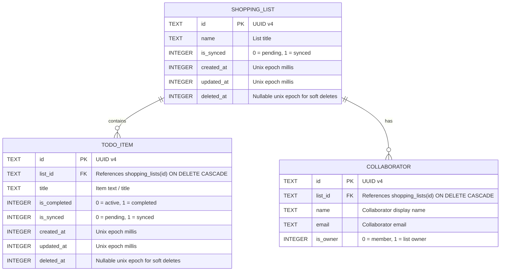

# Listix Database Architecture & Schema Specification

This document details the local-first SQLite database architecture, entity relationships, indexing strategies, and data synchronization design for **Listix**.

---

## 1. Architectural Philosophy: Offline-First SQLite

Listix operates on a **Local-First / Offline-First** principle:
- **Zero-Latency Interactions**: Every user action (creating a list, adding an item, checking off an item, inviting a collaborator) executes against the local SQLite database first via atomic transactions.
- **Resilient Connectivity**: The application functions without an internet connection. Changes are marked with `is_synced = 0`.
- **Background Synchronization**: A background sync worker reconciles un-synced local state with the backend service. Once confirmed by the remote server, records transition to `is_synced = 1`.

---

## 2. Entity-Relationship Diagram



---

## 3. Detailed Table Schemas

### A. `shopping_lists`
Stores the high-level lists owned by or shared with the user.

| Column | Type | Constraints | Description |
| :--- | :--- | :--- | :--- |
| `id` | `TEXT` | `PRIMARY KEY NOT NULL` | Unique client-generated UUID v4 |
| `name` | `TEXT` | `NOT NULL` | List display name (e.g. "Supermercado") |
| `is_synced` | `INTEGER` | `NOT NULL DEFAULT 0` | Sync state: `0` = local only, `1` = synced |
| `created_at` | `INTEGER` | `NOT NULL` | Milliseconds since Unix epoch |
| `updated_at` | `INTEGER` | `NOT NULL` | Milliseconds since Unix epoch |
| `deleted_at` | `INTEGER` | `NULL` | Soft delete timestamp for conflict sync |

### B. `todo_items`
Individual items contained within a shopping list.

| Column | Type | Constraints | Description |
| :--- | :--- | :--- | :--- |
| `id` | `TEXT` | `PRIMARY KEY NOT NULL` | Unique client-generated UUID v4 |
| `list_id` | `TEXT` | `NOT NULL, FK -> shopping_lists(id) ON DELETE CASCADE` | Parent list reference |
| `title` | `TEXT` | `NOT NULL` | Item text (e.g. "Leche deslactosada") |
| `is_completed`| `INTEGER` | `NOT NULL DEFAULT 0` | Completion state: `0` = pending, `1` = checked |
| `is_synced` | `INTEGER` | `NOT NULL DEFAULT 0` | Sync state: `0` = local only, `1` = synced |
| `created_at` | `INTEGER` | `NOT NULL` | Milliseconds since Unix epoch |
| `updated_at` | `INTEGER` | `NOT NULL` | Milliseconds since Unix epoch |
| `deleted_at` | `INTEGER` | `NULL` | Soft delete timestamp |

### C. `collaborators`
Collaborators who have joined or been invited to a shared list.

| Column | Type | Constraints | Description |
| :--- | :--- | :--- | :--- |
| `id` | `TEXT` | `PRIMARY KEY NOT NULL` | Unique client-generated UUID v4 |
| `list_id` | `TEXT` | `NOT NULL, FK -> shopping_lists(id) ON DELETE CASCADE` | Associated list reference |
| `name` | `TEXT` | `NOT NULL` | Member display name |
| `email` | `TEXT` | `NOT NULL` | Member email address |
| `is_owner` | `INTEGER` | `NOT NULL DEFAULT 0` | `1` if creator/owner, `0` otherwise |

---

## 4. Indexing Strategy

To guarantee snappy UI rendering and sub-millisecond sync queries on resource-constrained mobile hardware, the following indexes are maintained:

```sql
-- Fast lookup of all items belonging to a list
CREATE INDEX idx_todo_items_list_id ON todo_items(list_id);

-- Rapid query of items pending remote synchronization
CREATE INDEX idx_todo_items_is_synced ON todo_items(is_synced);

-- Rapid query of lists modified locally and pending synchronization
CREATE INDEX idx_shopping_lists_is_synced ON shopping_lists(is_synced);

-- Fast collaborator retrieval for active lists
CREATE INDEX idx_collaborators_list_id ON collaborators(list_id);
```

---

## 5. Synchronization & Conflict Resolution Protocol

1. **Client-Generated UUIDs**: All primary keys are UUID v4 values generated on the device. This guarantees that items created offline will never collide with items created by other collaborators or on the server.
2. **Sync Loop**:
   - `SELECT * FROM todo_items WHERE is_synced = 0;`
   - `SELECT * FROM shopping_lists WHERE is_synced = 0;`
   - Payload is pushed to the backend sync endpoint.
   - Upon HTTP 200 / successful acknowledgment:
     - `UPDATE todo_items SET is_synced = 1 WHERE id IN (...);`
     - `UPDATE shopping_lists SET is_synced = 1 WHERE id IN (...);`
3. **Conflict Resolution Strategy**:
   - Uses **Last-Write-Wins (LWW)** backed by `updated_at` timestamps for scalar updates (e.g. list name).
   - Uses additive merge for todo items (items created on different devices are both appended).
   - Deletions use soft-deletes (`deleted_at IS NOT NULL`) so remote deletions propagate cleanly without resurrecting deleted items.

---

## 6. Migration Roadmap (V2+)

In Version 2, the schema will be expanded via incremental SQLite migrations (`ALTER TABLE` or migration scripts):

- `todo_items.quantity` (`REAL DEFAULT 1.0`): Item quantity.
- `todo_items.unit` (`TEXT DEFAULT 'unidades'`): Measurement unit (kg, g, l, un).
- `todo_items.estimated_price` (`REAL`): Unit price estimate.
- `todo_items.actual_price` (`REAL`): Actual price paid at checkout.
- `todo_items.currency` (`TEXT DEFAULT 'USD'`): Currency code.
- `todo_items.category_id` (`TEXT FK -> categories(id)`): Grouping category.
- `shopping_lists.budget_limit` (`REAL`): Maximum spending threshold.
