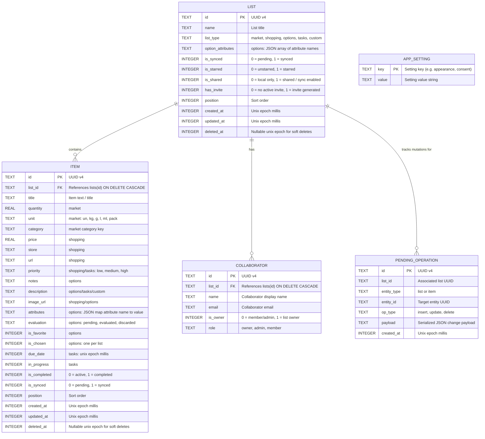

# Listix Database Architecture & Schema Specification

This document details the local-first SQLite database architecture, entity relationships, indexing strategies, and data synchronization design for **Listix**.

---

## 1. Architectural Philosophy: Offline-First SQLite

Listix operates on a **Local-First / Offline-First** principle:
- **Zero-Latency Interactions**: Every user action (creating a list, adding an item, checking off an item, inviting a collaborator) executes against the local SQLite database first via atomic transactions.
- **Resilient Connectivity**: The application functions without an internet connection. Changes are marked with `is_synced = 0`.
- **Background Synchronization**: A background sync worker reconciles un-synced local state with the backend service. Once confirmed by the remote server, records transition to `is_synced = 1`.

---

## 2. Entity-Relationship Diagram



---

## 3. Detailed Table Schemas

### A. `lists`
Stores the high-level lists owned by or shared with the user.

| Column | Type | Constraints | Description |
| :--- | :--- | :--- | :--- |
| `id` | `TEXT` | `PRIMARY KEY NOT NULL` | Unique client-generated UUID v4 |
| `name` | `TEXT` | `NOT NULL` | List display name (e.g. "Supermercado") |
| `list_type` | `TEXT` | `NOT NULL DEFAULT 'custom'` | List type: `market`, `shopping`, `options`, `tasks`, `custom` |
| `option_attributes` | `TEXT` | `NULL` | `options`: JSON array with the comparison attribute names configured for the list |
| `is_synced` | `INTEGER` | `NOT NULL DEFAULT 0` | Sync state: `0` = local only, `1` = synced |
| `is_starred` | `INTEGER` | `NOT NULL DEFAULT 0` | Starred priority state |
| `is_shared` | `INTEGER` | `NOT NULL DEFAULT 0` | `0` = private local only, `1` = shared & synced |
| `has_invite` | `INTEGER` | `NOT NULL DEFAULT 0` | `0` = no invite active, `1` = invite token active |
| `position` | `INTEGER` | `NOT NULL DEFAULT 0` | Display ordering position |
| `created_at` | `INTEGER` | `NOT NULL` | Milliseconds since Unix epoch |
| `updated_at` | `INTEGER` | `NOT NULL` | Milliseconds since Unix epoch |
| `deleted_at` | `INTEGER` | `NULL` | Soft delete timestamp for conflict sync |

### B. `items`
Individual items contained within a shopping list.

| Column | Type | Constraints | Description |
| :--- | :--- | :--- | :--- |
| `id` | `TEXT` | `PRIMARY KEY NOT NULL` | Unique client-generated UUID v4 |
| `list_id` | `TEXT` | `NOT NULL, FK -> lists(id) ON DELETE CASCADE` | Parent list reference |
| `title` | `TEXT` | `NOT NULL` | Item text (e.g. "Leche deslactosada") |
| `is_completed`| `INTEGER` | `NOT NULL DEFAULT 0` | Completion state: `0` = pending, `1` = checked |
| `is_synced` | `INTEGER` | `NOT NULL DEFAULT 0` | Sync state: `0` = local only, `1` = synced |
| `position` | `INTEGER` | `NOT NULL DEFAULT 0` | Display ordering position |
| `created_at` | `INTEGER` | `NOT NULL` | Milliseconds since Unix epoch |
| `updated_at` | `INTEGER` | `NOT NULL` | Milliseconds since Unix epoch |
| `deleted_at` | `INTEGER` | `NULL` | Soft delete timestamp |
| `quantity` | `REAL` | `NULL` | `market`: amount to buy |
| `unit` | `TEXT` | `NULL` | `market`: `un`, `kg`, `g`, `l`, `ml`, `pack` |
| `category` | `TEXT` | `NULL` | `market`: `produce`, `dairy`, `meat`, `bakery`, `pantry`, `beverages`, `cleaning`, `other` |
| `price` | `REAL` | `NULL` | `market`/`shopping`: estimated price (summed in the shopping list header) |
| `store` | `TEXT` | `NULL` | `shopping`: store name |
| `url` | `TEXT` | `NULL` | `shopping`: http(s) product link |
| `priority` | `TEXT` | `NULL` | `shopping`/`tasks`: `low`, `medium`, `high` |
| `notes` | `TEXT` | `NULL` | `options`/`tasks`/`custom`: free notes |
| `description` | `TEXT` | `NULL` | `options`/`tasks`/`custom`: short description |
| `image_url` | `TEXT` | `NULL` | `shopping`/`options`: optional http(s) image link (no local picker, so it needs connectivity to render; offline shows an icon) |
| `attributes` | `TEXT` | `NULL` | `options`: JSON object, attribute name to value |
| `evaluation` | `TEXT` | `NULL` | `options`: `pending`, `evaluated`, `discarded` |
| `is_favorite` | `INTEGER` | `NOT NULL DEFAULT 0` | `options`: favorite flag |
| `is_chosen` | `INTEGER` | `NOT NULL DEFAULT 0` | `options`: chosen option (at most one per list) |
| `due_date` | `INTEGER` | `NULL` | `tasks`: due date, milliseconds since Unix epoch |
| `in_progress` | `INTEGER` | `NOT NULL DEFAULT 0` | `tasks`: in-progress status (cleared when completed) |

Columns that do not apply to a list's type stay `NULL`/`0`. Existing databases gain the new columns on open (`_ensureColumns`) and existing lists default to `custom`.

### C. `collaborators`
Collaborators who have joined or been invited to a shared list.

| Column | Type | Constraints | Description |
| :--- | :--- | :--- | :--- |
| `id` | `TEXT` | `PRIMARY KEY NOT NULL` | Unique client-generated UUID v4 |
| `list_id` | `TEXT` | `NOT NULL, FK -> lists(id) ON DELETE CASCADE` | Associated list reference |
| `name` | `TEXT` | `NOT NULL` | Member display name |
| `email` | `TEXT` | `NOT NULL` | Member email address |
| `is_owner` | `INTEGER` | `NOT NULL DEFAULT 0` | `1` if creator/owner, `0` otherwise |
| `role` | `TEXT` | `NOT NULL DEFAULT 'member'` | Collaborator role (`owner`, `admin`, `member`) |

### D. `pending_operations`
Tracks offline mutations pending remote sync to the backend.

| Column | Type | Constraints | Description |
| :--- | :--- | :--- | :--- |
| `id` | `TEXT` | `PRIMARY KEY NOT NULL` | Unique operation UUID v4 |
| `list_id` | `TEXT` | `NOT NULL` | Target list reference |
| `entity_type` | `TEXT` | `NOT NULL` | Target entity: `'list'` or `'item'` |
| `entity_id` | `TEXT` | `NOT NULL` | UUID of the entity being mutated |
| `op_type` | `TEXT` | `NOT NULL` | Mutation type: `'insert'`, `'update'`, or `'delete'` |
| `payload` | `TEXT` | `NULL` | Serialized JSON mutation payload |
| `created_at` | `INTEGER` | `NOT NULL` | Milliseconds since Unix epoch |

### E. `app_settings`
Key-value storage for app-level configurations and preferences.

| Column | Type | Constraints | Description |
| :--- | :--- | :--- | :--- |
| `key` | `TEXT` | `PRIMARY KEY NOT NULL` | Unique preference identifier |
| `value` | `TEXT` | `NOT NULL` | Value string (e.g. appearance mode, ad consent) |

---

## 4. Indexing Strategy

To guarantee snappy UI rendering and sub-millisecond sync queries on resource-constrained mobile hardware, the following indexes are maintained:

```sql
-- Fast lookup of all items belonging to a list
CREATE INDEX idx_items_list_id ON items(list_id);

-- Rapid query of items pending remote synchronization
CREATE INDEX idx_items_is_synced ON items(is_synced);

-- Rapid query of lists modified locally and pending synchronization
CREATE INDEX idx_lists_is_synced ON lists(is_synced);

-- Rapid query of lists by shared status
CREATE INDEX idx_lists_is_shared ON lists(is_shared);

-- Fast collaborator retrieval for active lists
CREATE INDEX idx_collaborators_list_id ON collaborators(list_id);

-- Rapid lookup and queue execution of pending offline operations
CREATE INDEX idx_pending_ops_list ON pending_operations(list_id);
CREATE INDEX idx_pending_ops_created ON pending_operations(created_at);
```

---

## 5. Synchronization & Conflict Resolution Protocol

1. **Client-Generated UUIDs**: All primary keys are UUID v4 values generated on the device. This guarantees that items created offline will never collide with items created by other collaborators or on the server.
2. **Offline Mutation Queue**:
   - Every offline action records an entry in `pending_operations`.
   - The queue processor batches pending records, synchronizing mutations against the backend when connectivity is restored.
   - Upon successful server acknowledgment, local entities transition to `is_synced = 1` and corresponding pending operations are cleared.
3. **Conflict Resolution Strategy**:
   - Uses **Last-Write-Wins (LWW)** backed by `updated_at` timestamps for scalar updates (e.g. list name).
   - Uses additive merge for todo items (items created on different devices are both appended).
   - Deletions use soft-deletes (`deleted_at IS NOT NULL`) so remote deletions propagate cleanly without resurrecting deleted items.

---

## 6. Backup Data Schema & Portability Architecture

Listix provides an on-device backup and export mechanism designed for full data sovereignty, zero platform lock-in, and instant disaster recovery.

### A. JSON Backup Format (Schema v1)
Backups are serialized into formatted JSON containing schema versioning, metadata, and full relational hierarchies:

```json
{
  "version": 1,
  "exportedAt": "2026-10-08T00:00:00.000Z",
  "appVersion": "1.0.0",
  "lists": [
    {
      "id": "c3d18e8b-2d7c-4822-b2be-dcf444bbff30",
      "name": "Supermercado",
      "type": "market",
      "isStarred": 1,
      "position": 0,
      "createdAt": 1727000000000,
      "updatedAt": 1727000000000,
      "items": [
        {
          "id": "e4f29a1c-3e8d-4933-a3cf-edf555cc0041",
          "listId": "c3d18e8b-2d7c-4822-b2be-dcf444bbff30",
          "title": "Leche deslactosada",
          "quantity": 2,
          "unit": "l",
          "category": "dairy",
          "isCompleted": 0,
          "position": 0,
          "createdAt": 1727000000000,
          "updatedAt": 1727000000000
        }
      ]
    }
  ]
}
```

Type and item detail fields are optional and omitted when empty, so schema v1 backups remain readable (missing `type` restores as `custom`).

### B. CSV & Plain Text Exports
- **CSV Export**: Tabular representation (`"List,Item,Status,Created"`) compatible with Google Sheets, Microsoft Excel, and Apple Numbers.
- **Plain Text Summary**: Human-readable markdown checklist (`[ ] Item`, `[x] Item`) formatted for direct sharing via messaging apps or note-taking tools.

### C. Atomic Restore & Conflict Resolution
Restoring from a backup file executes inside an atomic SQLite transaction (`db.transaction(...)`):
- **Replace Existing (`replaceExisting = true`)**:
  1. Deletes all records from `items`, `collaborators`, and `lists`.
  2. Inserts all lists and items from the backup payload with `is_synced = 1`.
  3. Guarantees transactional rollback if parsing or insertion encounters invalid records.
- **Merge (`replaceExisting = false`)**:
  1. Inspects existing list IDs.
  2. Existing lists preserve their current local state; missing lists and missing items are appended seamlessly.
  3. Ensures no existing user lists are lost during restoration.

---

## 7. Migration Roadmap (V2+)

In future versions, the schema will be expanded via incremental SQLite migrations (`ALTER TABLE` or migration scripts):

- `items.currency` (`TEXT DEFAULT 'USD'`): Currency code for `price`.
- `lists.budget_limit` (`REAL`): Maximum spending threshold.
- Remote sync of `list_type` and item detail columns (the REST adapter currently only carries title, completion and position).
